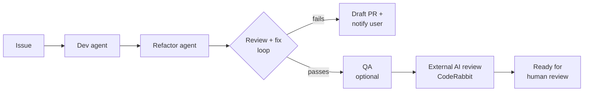

# AI Agent Skills

AI agent skills to plan, build, review, and ship code.

## Orchestrator

[Orchestrator](operator/SKILL.md) coordinates a team of agents to take a GitHub issue to a review-ready PR.

Used to build [Cardcase](https://github.com/tyler-mcdonald/cardcase), a live full-stack app.



- **Autonomous.** Runs from issue to PR and only stops when it needs a person.
- **Pre-reviewed.** Separate agents review and fix the code against the issue's goals, so PRs arrive already reviewed.
- **Safe by default.** Never merges or force-pushes. Every merge needs human approval.
- **Cost-controlled.** Caps review rounds and wait times to keep token use and runtime predictable.

## Setup

```sh
git clone https://github.com/tyler-mcdonald/skills.git ~/.claude/skills
```

Requires the `gh` CLI. Bot review in CI uses [agent-workflows](https://github.com/tyler-mcdonald/agent-workflows).
