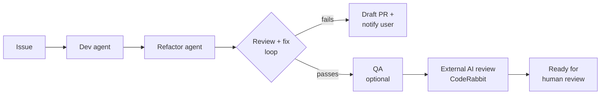

# AI Agent Skills

Claude Code skills that plan, build, review, and ship code.

## Orchestrator

[Orchestrator](orchestrator/SKILL.md) takes a GitHub issue to a pull request that's ready for review. It hands each step to a separate agent.

Used to build [Cardcase](https://github.com/tyler-mcdonald/cardcase).



- Runs on its own from issue to PR, and stops only when it needs a person.
- Separate agents check the code against the issue's requirements and fix problems before the PR is opened.
- Never merges or force-pushes. A human approves every merge.
- Limits review rounds and wait times so cost and runtime stay predictable.

## Other skills

- [plan-issue](plan-issue/SKILL.md): writes an implementation plan into a GitHub issue
- [code-review-cycle](code-review-cycle/SKILL.md): reviews a branch and fixes findings until it's ready to merge
- [handle-pr-review](handle-pr-review/SKILL.md): addresses and replies to PR review comments
- [router](router/SKILL.md): sends a new chat's first request to the right workflow

## Setup

```sh
git clone https://github.com/tyler-mcdonald/skills.git ~/.claude/skills
```

Automated bot review in CI uses [agent-workflows](https://github.com/tyler-mcdonald/agent-workflows).
